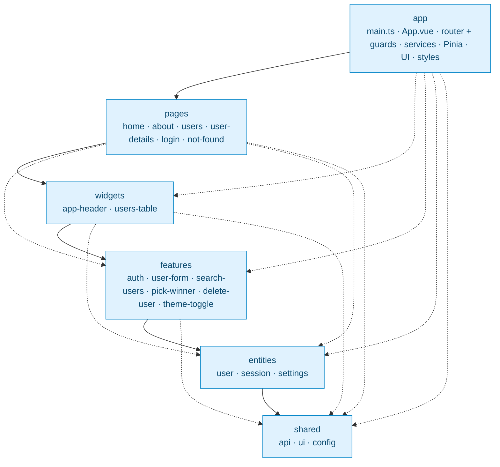

# vue-lottery-app

Лабораторна робота №6 — **Feature-Sliced Design (FSD)**, керування станом у **Pinia** та
**UI-бібліотека PrimeVue** (гілка `feature/fsd`, створена від `feature/routing`).
Функціонал лабораторної №5 збережено: маршрутизація, користувачі (DummyJSON), JWT-авторизація,
патерн Repository.

Стек: Vue 3 (Composition API, `<script setup>`) + TypeScript, Vue Router, Pinia (setup stores),
PrimeVue + SCSS, VeeValidate + yup, Vite, ESLint (+ `eslint-plugin-boundaries`).

## Запуск

```bash
npm install
cp .env.example .env     # на Windows: copy .env.example .env
npm run dev              # dev-сервер
npm run build            # vue-tsc + збірка у dist/ (+ dist/404.html для GitHub Pages)
npm run lint             # ESLint (включає правила FSD)
npm run lint:fsd         # лише правила FSD (eslint-plugin-boundaries)
```

Тестовий акаунт: **emilys / emilyspass**. Змінні середовища (`.env`): `VITE_API_URL`,
`VITE_BASE_PATH` (див. `.env.example`).

## Структура (FSD)

```
src/
├── app/
│   ├── providers/
│   │   ├── router/index.ts   # createRouter, маршрути, guard-и, title
│   │   ├── services.ts       # реєстрація UserService та AuthService у ServiceProvider
│   │   ├── store.ts          # Pinia + pinia-plugin-persistedstate
│   │   └── ui.ts             # PrimeVue: тема, темний режим, ToastService
│   ├── layouts/              # DefaultLayout, AuthLayout (через meta.layout)
│   ├── styles/main.scss      # глобальні стилі на токенах теми PrimeVue
│   ├── App.vue
│   └── main.ts
├── pages/        home · about · users · user-details (+ UserEditPage) · login · not-found
├── widgets/      app-header (AppHeader + AppNavigation + Logo) · users-table
├── features/     auth · user-form · search-users · pick-winner · delete-user · theme-toggle
├── entities/     user · session · settings
└── shared/
    ├── api/      http-client, інтерфейси Repository, ServiceProvider
    ├── ui/       AppButton, AppInput, AppSelect, AppTable, AppDialog, AppConfirmDialog, ...
    └── config/   AUTHOR, PROJECT, APP_TITLE
```

Кожен слайс має `index.ts` (Public API). Приклад: `@/entities/user` віддає `User`, `CreateUserDto`,
`UpdateUserDto`, `UserService`, `useUsersStore`, `PAGE_SIZE`.

### Діаграма залежностей шарів

Стрілка означає «може імпортувати з». Слайси одного шару одне одного не імпортують.



### Перевірка правил FSD лінтером

`.eslintrc.fsd.json` налаштовує `eslint-plugin-boundaries`:

- `boundaries/element-types` — тільки імпорти «вниз» по шарах; слайси одного шару одне одного не
  імпортують (`features/auth` ↛ `features/user-form`); `shared` не залежить від `entities`;
- `boundaries/entry-point` — імпорт «вглиб» слайса заборонений, лише через `index.ts`
  (`@/entities/user/model/users.store` — помилка, `@/entities/user` — ок);
- динамічні імпорти (`import('@/pages/users')`) у роутері теж перевіряються.

`npm run lint:fsd` запускає тільки ці правила, `npm run lint` — усі правила разом (FSD підключено
через `extends`). Усі помилки виправлені. Перевірено негативними прикладами: імпорт `features →
features`, `entities → features`, `shared → entities` та глибокий імпорт — лінтер повідомляє про
помилку.

## Repository у FSD

| Частина | Розташування |
| --- | --- |
| HTTP-клієнт, `Readable`, `Creatable`, `Editable`, `Deletable`, `Searchable` | `shared/api` |
| `User`, `CreateUserDto`, `UpdateUserDto` | `entities/user/model/types.ts` |
| `UserService` | `entities/user/api/user.service.ts` |
| `AuthService`, типи авторизації | `entities/session/api`, `entities/session/model` |
| `ServiceProvider` (універсальний реєстр) | `shared/api/service-provider.ts` |
| Реєстрація `UserService` та `AuthService` | `app/providers/services.ts` |

`ServiceProvider` з лаби №5 імпортував `UserService` напряму, а `shared` не може залежати від
`entities`. Тепер це універсальний реєстр (`register(key, factory)` / `get<T>(key)`), а конкретні
сервіси реєструє шар `app`, який може імпортувати з усіх шарів.

## Pinia

- `useSessionStore` (`entities/session`): `user`, `accessToken`, `refreshToken`, `isAuthenticated`,
  `setSession` / `clearSession`, `login`, `logout`, `refreshAccessToken`, `initSession`.
- `useUsersStore` (`entities/user`): `users`, `total`, `hasUsers`, `isLoading`, `error`,
  `fetchUsers`, `fetchUser`, `createUser`, `updateUser`, `removeUser`. Після створення, редагування
  й видалення стор сам оновлює стан (DummyJSON лише імітує запис).
- `useSettingsStore` (`entities/settings`): тема (`light` / `dark`), зберігається плагіном.
- `useWinnersStore` (`features/pick-winner`): переможці лотереї.

Усі стори — setup stores; у компонентах стан беремо через `storeToRefs`, дії деструктуруємо
напряму. Сторінки й віджети звертаються лише до сторів, а не до сервісів.

### Ручне збереження (session) проти `pinia-plugin-persistedstate` (settings)

| | Ручна реалізація (`session.store.ts`) | `pinia-plugin-persistedstate` (`settings.store.ts`) |
| --- | --- | --- |
| Код | `loadSession`, `persist`, `setSession`, `clearSession` (~25 рядків) | одна опція `persist: { key, pick: ['theme'] }` |
| Гнучкість | повний контроль: зберігаємо лише коли є всі токени, видаляємо ключ при виході, один JSON | задає лише ключ, список полів і сховище |
| Коли зберігається | у конкретних місцях (`setSession`, оновлення токена) | автоматично після кожної зміни стану |
| Ризик помилок | можна забути викликати `persist()` | немає |
| Підходить для | складної логіки (токени, умови очищення) | простих налаштувань (тема, мова) |

## UI-бібліотека (PrimeVue)

- Підключено окремі компоненти (`primevue/button`, `primevue/datatable`, ...) — у збірку потрапляє
  лише те, що використано (tree-shaking); пресет Aura + основний колір `sky` (близько до синього
  дизайну), темна тема — клас `.app-dark` на `<html>` (`app/providers/ui.ts`).
- Обгортки в `shared/ui`: `AppButton`, `AppInput` (показує помилку валідації), `AppSelect`,
  `AppTable`, `AppDialog`, `AppConfirmDialog` (підтвердження видалення), `AppPagination`,
  `AppMessage`, `AppSpinner`, `AppToast` + `useAppToast`.
- Компоненти PrimeVue імпортуються лише в `shared/ui` та `app/providers/ui.ts`.
- Сповіщення (toast): користувача створено / оновлено / видалено, помилки операцій та авторизації.
- VeeValidate інтегровано з `AppInput` / `AppSelect` у формі входу (`features/auth`) та формі
  користувача (`features/user-form`).
- Перемикач світлої/темної теми: `features/theme-toggle` + `entities/settings`.

## Автентифікація (без змін відносно лаби №5)

JWT: `POST /auth/login`, заголовок `Authorization: Bearer` для `GET /auth/me`, автоматичне оновлення
`accessToken` через `POST /auth/refresh` при відповіді 401 (interceptor у `shared/api/http-client.ts`,
обробники підключає `app/main.ts`), guard `beforeEach` із `meta.requiresAuth` та `redirect`
(`app/providers/router`).

## Порядок виконання (історія комітів)

1. `chore: add Pinia, UI library, FSD linter`
2. `refactor: introduce FSD folder structure`
3. `refactor: split Repository across FSD layers`
4. `feat: add Pinia stores - session and users`
5. `feat: add shared/ui wrappers`
6. `refactor: use wrappers and stores in pages and widgets`
7. `chore: fix FSD lint errors`

## Що перевірено (відсутність регресій)

Наскрізний сценарій (jsdom, мок API): гість на `/users?page=2` → `/login?redirect=...` → валідація й
помилка входу (у формі та toast) → успішний вхід і повернення на `/users?page=2`; пункт меню
Users активний; пагінація (нумерація колонки #), пошук через `?q=`; максимум 3 переможці та
неактивна кнопка; створення користувача (діалог + toast + рядок у таблиці); видалення з підтвердженням;
`/users/:id`, вкладений `/users/:id/edit`, 404; перемикач теми зберігається в `localStorage`;
Logout → `/login`.

## Контрольні запитання

1. **Що таке FSD і які проблеми вирішує?** Методологія організації фронтенд-коду: де розміщувати код
   і які модулі від яких можуть залежати. Вирішує хаос у структурі (папки «components», «utils», де
   все змішане), складність пошуку коду, циклічні залежності та проблеми масштабування й командної
   роботи.
2. **Які шари і в якому порядку?** Від найвищого до найнижчого: `app` → `pages` → `widgets` →
   `features` → `entities` → `shared`. Чим вище шар, тим більше він знає про застосунок; нижні шари
   більш загальні й повторно використовувані, тому не повинні залежати від верхніх.
3. **Головне правило імпортів.** Модуль імпортує лише з шарів, що **нижче**. `features` може
   імпортувати з `entities` та `shared`, але **не** з `widgets`.
4. **Чому слайси одного шару не імпортують один одного?** Так слайси лишаються незалежними (можна
   змінити чи видалити один, не зачепивши інший) і не виникає циклів. Якщо потрібен спільний код,
   його піднімають у нижній шар (`entities` чи `shared`) або об'єднують на верхньому шарі (сторінка
   чи віджет оркеструє кілька слайсів — як `UsersPage` після `removeUser` викликає
   `removeWinner`).
5. **Слайс і сегмент.** Слайс — розбиття всередині шару за предметною областю (`entities/user`,
   `features/auth`). Сегмент — розбиття слайса за технічним призначенням: `ui`, `model`, `api`,
   `lib`, `config`.
6. **Public API слайса.** Файл `index.ts`, що реекспортує дозволене. Інші слайси імпортують лише
   через нього, тож внутрішню структуру слайса можна змінювати без поломки споживачів. Глибокий
   імпорт заборонено лінтером.
7. **`entities` проти `features`.** `entities` — бізнес-сутності (дані й правила): `user`
   (типи, `UserService`, store), `session`, `settings`. `features` — дії користувача з
   бізнес-цінністю: `auth` (вхід/вихід), `user-form`, `search-users`, `pick-winner`, `delete-user`.
8. **Чому `app` та `shared` не діляться на слайси?** Вони не мають предметної області: `app` — це
   ініціалізація всього застосунку, `shared` — універсальний код без бізнес-логіки. Тому вони
   складаються безпосередньо із сегментів.
9. **Чому `ServiceProvider` не можна залишити як у лабі №5?** Він напряму імпортував `UserService`
   з `entities`, а `shared` не може залежати від `entities`. Рішення: універсальний реєстр
   `register(key, factory)` / `get<T>(key)` у `shared/api`, а реєстрація сервісів — у
   `app/providers/services.ts`.
10. **Pinia проти composable зі спільним `ref`.** Pinia дає єдине зареєстроване сховище з ідентифікатором,
    підтримкою Devtools (історія змін), плагінів (persistedstate), `$reset`/`$subscribe`, керованим
    життєвим циклом та простою взаємодією зі сторами поза компонентами (guard). Composable зі спільним
    `ref` теж працює, але все це доведеться писати вручну.
11. **Options stores і setup stores; `storeToRefs`.** Options store описується об'єктом
    (`state`, `getters`, `actions`), setup store — функцією у стилі Composition API (`ref` =
    state, `computed` = getters, функції = actions). `storeToRefs(store)` перетворює state та getters
    на `ref`-и, зберігаючи реактивність при деструктуризації.
12. **Чому не деструктуризувати state без `storeToRefs`?** При прямій деструктуризації
    (`const { users } = store`) ми отримуємо звичайне значення в момент виклику, і воно перестає
    оновлюватись. `storeToRefs` повертає `ref`-и, які лишаються реактивними (actions можна
    деструктуризувати напряму, бо це функції).
13. **Чому не звертатися до сервісів з компонентів?** Тоді логіка завантаження, обробки помилок і
    оновлення стану розкидається по компонентах і дублюється. Стор централізує стан
    (`isLoading`, `error`, дані), тож усі компоненти бачать однакові дані, а компоненти залишаються
    тонкими й тестованими.
14. **Навіщо обгортки UI-компонентів у `shared/ui`?** Залежність від бібліотеки зосереджена в одному
    шарі: заміна PrimeVue на іншу бібліотеку зачіпає лише `shared/ui`. Також обгортки задають
    єдиний API (наприклад, `AppInput` одразу показує помилку валідації) й спрощують використання.
15. **Tree-shaking і як підключати лише потрібні компоненти.** Tree-shaking — видалення
    невикористаного коду зі збірки. Для UI-бібліотеки імпортуємо окремі компоненти
    (`import Button from 'primevue/button'`) або використовуємо auto-import, а не реєструємо всю
    бібліотеку глобально.
16. **Переваги й недоліки FSD для невеликого застосунку.** Переваги: передбачувана структура,
    чіткі залежності, легко масштабувати й працювати командою, лінтер захищає архітектуру.
    Недоліки: багато папок і `index.ts`-файлів для невеликого обсягу коду, вищий поріг входу,
    спокуса «перероздрібнити» слайси (для `vue-lottery-app` це певною мірою надлишково).
